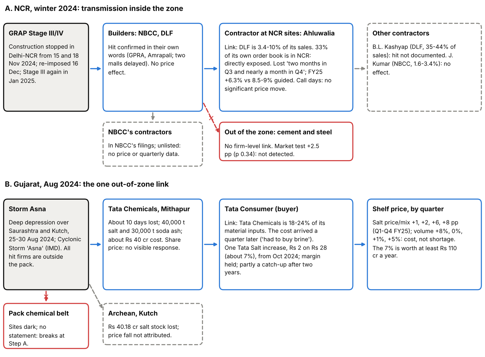

**Supporting files:** the full evidence is in `outputs/deliverables/`: the pathway diagrams and evidence tables per node,
the links file, and tables 1–3 with their notes. Every quote used was checked by script against the saved original
document.

## 1. Question and method

When a localized, documented extreme event damages firms, does the damage travel along supply chains to firms outside
the zone? We traced two events firm by firm. For each node:

- the hit is confirmed from the firm's own documents;
- links are verified, with a dependence weight;
- the node is measured by its CAR (market model against NIFTY 500; p-values from the same statistic on 1,000 random
  days) and its next quarterly numbers;
- the disclosure that names the channel is found and the confounds are ruled out.

Each pathway rests on fewer than ten firms, so the statistics have little power and are read as such.

## 2. NCR, winter 2024: transmission inside the zone

**The shock.** CAQM's GRAP orders stopped construction and demolition in Delhi-NCR: Stage III from 15 Nov 2024,
Stage IV from 18 Nov. Restrictions were re-imposed on 16 Dec and returned for four Stage III spells in January–February
2025.

**Hit builders.**

- NBCC (94% of its plant cost in NCR): Amrapali and 70% of its GPRA redevelopment were "severely hitted by the NGT".
- DLF (42%): "the 2 malls in the Delhi NCR were a little delayed because of the GRAP".
- Neither stock responded: +0.4 pp against developers with no NCR project over (−1,+5), p = 0.91. DLF's construction
  outflow rose in the ban quarter.

**Transmission ran builder to contractor at NCR sites.**

- **Link:** DLF is 3.4–10% of Ahluwalia's sales.
- **Own exposure:** Ahluwalia has 33.3% of its order book in NCR, so it is **directly exposed**. Its own sites were
  under the same ban.
- **Statements:** "GRAP-IV is in place … going to impact this quarter" (18 Nov 2024). FY25 growth guided down to
  "8.5%-9%" (12 Feb 2025). "we lost approximately two to three months, two months in Q3 and nearly a month in Q4 of
  FY '25" (2 Jun 2025).
- **Numbers:** Q3 FY25 turnover −7.3% YoY; FY25 +6.3%, below the guidance.

**Price evidence: results days and call days** (net of the five unlinked contractors):

- **18 Nov (Q2 results day; also the ban's day 0):** −4.7% (p = 0.04). The stock was already down 2.8% by 10:32 on the
  profit fall.
- **19 Nov (first day the Q2 call is priced; the call began at 3.00 pm on 18 Nov):** −1.3% (p = 0.55).
- **12 Feb (Q3 results day):** −4.0% (p = 0.08).
- **13 Feb (the 4.00 pm call's guidance cut):** −2.2% (p = 0.28).
- **The days that price the company's ban statements show no significant move.** Larger falls later (−32% and −18%
  net) contain no Ahluwalia disclosure and are not attributed.

**The other nodes.**

- **B.L. Kashyap** (DLF is 35–44% of its sales): its revenue was already falling before the ban, so it is not confirmed.
- **J. Kumar** (NBCC is 1.6–3.4% of its sales): no effect, as expected at that dose.
- **NBCC's GPRA contractors are unlisted** (Varindera, Shapoorji Pallonji & Co. Pvt, Girdhari Lal Constructions Pvt),
  as is Gaursons on Amrapali (trade press only). There is no price or filed quarterly data, so the branch is closed.

**Out of the zone: not detected.**

- No document links any cement or steel firm to the builders.
- DLF's FY24 construction outflow is at most 0.7–14% of any listed supplier's revenue.
- A coarse market test (makers with northern capacity minus makers with none) gives +2.5 pp over (−1,+5), p = 0.34.

## 3. Gujarat, August 2024: the one out-of-zone link

**The shock.**

- The pack's "Gujarat floods — Vadodara/central Gujarat" event was the deep depression over Saurashtra and Kutch that became Cyclonic Storm Asna
  (IMD, 30 Aug 2024).
- The pack's own chemical belt breaks at Step A. Its Vadodara sites went dark, but no firm says anything, and its
  stocks beat their controls (+5.5 pp, p = 0.05) while the controls themselves fell 4.7%.

**Hit firms, all external to the pack:**

- **Material:** Tata Chemicals at Mithapur ("almost 10 days"; 40,000 t salt; about Rs 40 cr cost) and Archean in Kutch
  (Rs 40.18 cr of salt stock).
- **Confirmed but immaterial:** Adani Ports ("4 days equivalent"; August cargo still +5%) and GE T&D (no damage).
- **Tata Chemicals' share price shows nothing:** abnormal return −0.1% over 26–30 Aug and +1.1% on its results day
  (daily s.d. 2.3%). The shock is documented in statements and tonnes, not in the share price.
- **Archean's 15.8% fall** (11.7% net of specialty peers) spans the storm days. It fell 1–2.6% a day as Kachchh took
  61–98 mm, then 4.8% on 2 Sep in 1 mm of rain. At about Rs 1,560 cr it is 30–40 times the booked loss. **Not
  attributed.**

**The link: Tata Chemicals → Tata Consumer (edible salt).**

- Both sides document it: Tata Consumer is the "single customer" for Tata Chemicals' edible salt, and sources "more
  than 85%" of its salt from it.
- Tata Chemicals is 18–24% of Tata Consumer's material input cost.

**The cost was passed into the retail price, partly as a catch-up.**

- Mithapur "had to buy brine". The cost reached Tata Consumer a quarter later.
- Tata Consumer raised Tata Salt once: "INR2 on a INR28 base, which is roughly around 7%", from October 2024. That
  increase "comes after a two-year hiatus", in which "we've not even taken general cost of inflation increase".
- Margin held.
- **Magnitude:** no document gives the share of the storm cost that was passed on. The increase is worth at least
  Rs 110 cr a year (7% of FY24 purchases of Rs 1,576.64 cr), about 2.8 times the storm's whole cost to Tata Chemicals.
- **Cost, not shortage:** price/mix rose while volume kept growing.

| Tata Salt, FY25 (company documents) | Q1 | Q2 | Q3 | Q4 | FY25 |
|---|---|---|---|---|---|
| Revenue growth | +9% | +2% | +7% | +13% | +8% |
| Volume growth | +8% | flat | +1% | +5% | +4% |
| Implied price/mix (pp) | +1 | +2 | +6 | +8 | +4 |

**Lag:** one quarter. Tata Consumer's −6.7% on its results day is tea-driven by its own account. Tata Chemicals' moves
on 10 Oct (Ratan Tata's death) and 21 Oct (RBI ruling on Tata Sons' listing) are unrelated.

{width=100%}

## 4. How strong is it

| Claim | Evidence | Strength |
|---|---|---|
| NCR: ban → builders → contractor, inside the zone | own statements at every node; contractor revenue, guidance, lost months; call days show no price move | documented; price evidence weak |
| NCR: out-of-zone suppliers | no firm link; market test +2.5 pp (p = 0.34) | not detected (low power) |
| Gujarat: Tata Chemicals → Tata Consumer → shelf price | both sides document the link and weights; buyer gives cost, lag, price and margin; price/mix by quarter | documented; partly a catch-up; no price effect at either firm |
| Gujarat: the pack's chemical belt | dark sites, no statement, wrong-sign test | breaks at Step A |

**Results tables.**

- **(i) Direct test:** no negative response at the confirmed NCR builders, and a wrong-sign response in the Gujarat
  belt. The DiD is descriptive only.
- **(ii) Dose-response:**
  - Eight contractors: three linked and five at zero dose. Dose = the builder's share of the contractor's sales × the
    builder's NCR exposure.
  - With eight firms, the dose cannot be separated from the contractors' own NCR exposure, which only Ahluwalia and
    B.L. Kashyap disclose.
  - No relation with any CAR (exact permutation p = 0.67–1.00). The one significant slope, on Q3 sales, is matched by
    the same slope on the quarter before the ban: it is B.L. Kashyap's earlier decline.
  - Gujarat has one link, so there is no slope.
- **(iii) Placebos:** nulls.
  - NCR's 24 unexposed, unlinked firms: means −1.3% to +2.3%, p ≥ 0.30.
  - Gujarat's list drops Reliance Power. It fell 20.7% after SEBI's order of 22 Aug 2024 against Anil Ambani. Without
    it, the mean is −3.6% (p = 0.21) and the median −2.1%.
  - Half of Unitech's −16.7% is a market-model artefact of its 2024 rally. Tata Steel is flagged as a Tata group firm.

**Confounds carried:**

- Ahluwalia's results on the ban's day 0; the January recurrences; the small- and mid-cap sell-off of Jan–Feb 2025;
  Q4 seasonality.
- Tea costs; the price catch-up; soda-ash imports and new capacity.
- The fall in the Gujarat controls, all six firms (cause not identified).

## 5. What the manual trace caught that an automated pipeline would have missed or got wrong

1. **The wrong firms.** The pack's Gujarat footprint points at a chemical belt that said nothing. The firms the storm
   hit are outside the pack and its districts, and the pack's label for the event, a Vadodara flood, misses the storm.
2. **A link that does not exist.** The scaffold's cement/steel → construction link has no firm-level support. The real
   transmission is to contractors inside the zone.
   - Links counted earlier were wrong: Petronet without a confirmed source shock; the Aarti–UPL joint venture before
     it supplied; a Capacit'e–NBCC order dated after the event.
3. **Exposure mistaken for propagation.** Ahluwalia has a third of its book in NCR. A pipeline would credit its hit to
   the DLF link.
4. **The shock's own name.** Companies call the GRAP order "the NGT ban", and one transcript spells GRAP "graph". A
   keyword search misses both.
5. **False entity matches.** "ACC India Pvt Ltd", a DLF contractor, is not ACC Ltd the cement maker.
6. **Timing.** Results come out after the close (Tata Consumer at 16:52, priced the next trading day; Ahluwalia on 14 Nov,
   before a holiday), calls run late (3.00 pm and 4.00 pm, priced the next day), and transcripts are filed days later.
   Dated by filing, the guidance cut would sit in the wrong window: our own first reading did exactly that, and the
   review caught it.
7. **Unrelated moves.** Tea at Tata Consumer; the Tata Sons listing ruling and Ratan Tata's death at Tata Chemicals;
   SEBI's order at Reliance Power; the Adani indictment at ACC and Ambuja; IGL's gas cut; a PSU rally; Unitech's model
   alpha. A pipeline would score each as a shock response.
8. **Magnitudes.** DLF's construction spend rose; Archean's price fall is 30–40 times its loss; the salt price increase
   is 2.8 times the storm's cost; B.L. Kashyap's earlier decline makes a dose-response slope look significant.
9. **Double counting.** "₹2" and "7%" are the same increase.
10. **Overlapping shocks.** Tata Chemicals dates its loss to "July and August", so the loss cannot be split between
    the two episodes.
11. **Documents versus summaries.** The 85% statement is on a web page, not in the report's PDF; Tata Consumer's Q2
    deck yields no text to the page reader and had to be read from the PDF; snippets got a results date and a mall
    wrong; some filings refuse automated access, and these are recorded as gaps.

## 6. Open items

- **Yours:** Signature Global's Q3 FY25 transcript, and the final causal claim.
- **The Gujarat placebo re-screen is partial.** Six firms' own annual reports were not read: Jindal Steel & Power,
  Jindal Stainless, Lodha, NBCC, SAIL and NMDC. Supplier-side documents show no link for them.
- **Gaursons–Amrapali** rests on trade press.
- **GE T&D:** its 6 Sep 2024 filing was read. It cites the 27 Aug disclosure and reports "no damage to the property"
  except production disruption, because "the labor was unable to reach to the Plant".
